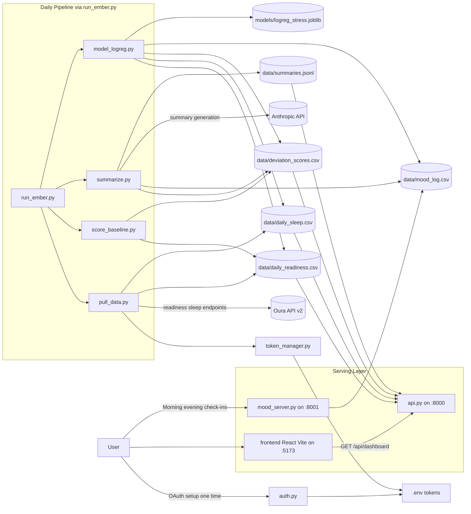
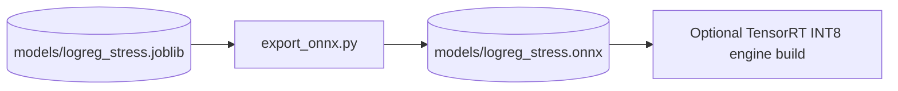

# EMBER System Diagram (model branch)

Source of truth for this diagram:
- Branch: model
- Scope: files currently present in this branch

## End-to-End Runtime Flow

## Model Export Flow (branch-specific)

## Runtime Boundaries

- External dependencies:
  - Oura OAuth and usercollection APIs
  - Anthropic messages API
- Local persistence:
  - data directory CSV and JSONL files
  - logs/ember.log
  - .env token and key material
  - models artifacts in models/
- Local services:
  - Dashboard API on 8000
  - Mood service on 8001
  - Frontend dev server on 5173
